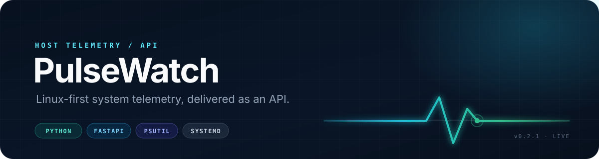
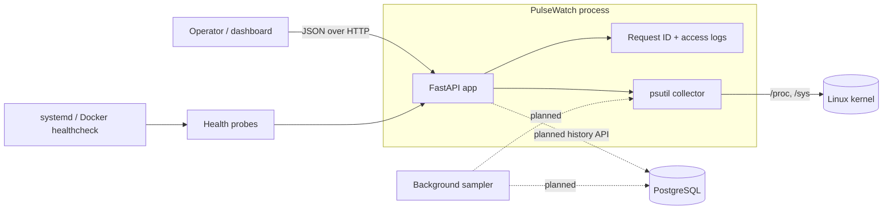

<div align="center">
  
</div>

<h1 align="center">PulseWatch</h1>

<p align="center">
  A Linux-first system monitoring service built with Python, FastAPI, and psutil.
  <br>
  Typed. Observable. Tested. Ready for a real Linux host.
</p>

<p align="center">
  <a href="https://github.com/sirsona/pulsewatch/actions/workflows/ci.yml"></a>
  <a href="https://github.com/sirsona/pulsewatch/blob/main/LICENSE"></a>
  
  
</p>

> [!NOTE]
> **Project status: early development (`v0.1.0`).** Live host metrics, health
> probes, structured logging, error handling, packaging, tests, and CI are
> implemented. PostgreSQL-backed history, background sampling, and retention
> are the next milestones. See the [roadmap](#roadmap).

## Overview

PulseWatch turns the telemetry available on a Linux host into a small, stable
HTTP API. It reads CPU, memory, disk, and network data through
[psutil](https://github.com/giampaolo/psutil), exposes point-in-time snapshots
as JSON, and is designed to run either as a hardened **systemd** service or in a
**container**.

The project is intentionally built beyond the happy path: typed configuration,
RFC 9457 error responses, request correlation IDs, JSON logs, deterministic
tests, packaging, and deployment assets are part of the repository from the
start.

### What works today

| Capability | Status |
| --- | --- |
| CPU, memory, disk, and network snapshots | ✅ Implemented |
| Versioned REST API with OpenAPI docs | ✅ Implemented |
| Liveness and readiness probes | ✅ Implemented |
| Structured JSON logs + request IDs | ✅ Implemented |
| RFC 9457 problem-details errors | ✅ Implemented |
| Typed config, Ruff, mypy, pytest, coverage gate | ✅ Implemented |
| GitHub Actions CI | ✅ Implemented |
| Multi-stage Docker image + Compose file | ✅ Starter included |
| Hardened systemd unit | ✅ Starter included |
| PostgreSQL metric history | 🚧 Planned |
| Background sampler and retention | 🚧 Planned |

## Architecture



A request passes through the correlation/access-log middleware, is routed to a
typed endpoint, and is served by a synchronous collector running in FastAPI's
worker thread. Errors are converted into a consistent problem-details envelope
with the same request ID returned in the response header.

See [docs/architecture.md](docs/architecture.md) for the request lifecycle and
the planned persistence design.

## Quick start

### Requirements

- Linux (the service is Linux-first; psutil also supports other Unix systems)
- Python **3.12+**
- [uv](https://docs.astral.sh/uv/) for dependency management

```bash
git clone https://github.com/sirsona/pulsewatch.git
cd pulsewatch

uv sync
cp .env.example .env
uv run pulsewatch --reload
```

The API is now available at:

- API documentation: <http://127.0.0.1:8000/docs>
- Liveness: <http://127.0.0.1:8000/health/live>
- Metrics: <http://127.0.0.1:8000/api/v1/metrics/current>

```bash
curl -s http://127.0.0.1:8000/api/v1/metrics/current | python -m json.tool
```

### Run the quality gates

```bash
make check        # Ruff + mypy + pytest with coverage
make test         # pytest only
make lint         # Ruff
make typecheck    # mypy
```

The suite enforces **85% branch coverage**. CI runs the tests on Python 3.12 and
3.13, then builds the production container and smoke-tests its readiness probe.

## API

All application endpoints are versioned under `/api/v1`; operational probes are
intentionally unversioned.

| Method | Path | Purpose |
| --- | --- | --- |
| `GET` | `/` | Service metadata and links |
| `GET` | `/health/live` | Process liveness probe |
| `GET` | `/health/ready` | Readiness probe, including collector health |
| `GET` | `/api/v1/metrics/current` | Current host metrics snapshot |
| `GET` | `/docs` | Interactive OpenAPI documentation |
| `GET` | `/openapi.json` | OpenAPI schema |

### Sample response

```json
{
  "timestamp": "2026-11-10T17:02:43.521912Z",
  "hostname": "ops-01",
  "platform": "Linux-6.8.0-45-generic-x86_64-with-glibc2.39",
  "boot_time": "2026-11-10T06:58:31+00:00",
  "uptime_seconds": 36252.52,
  "cpu": {
    "usage_percent": 14.2,
    "logical_cores": 8,
    "physical_cores": 4,
    "per_core_percent": [11.0, 18.5, 9.0, 25.0, 12.5, 8.0, 15.0, 14.0],
    "load_average_1m": 0.42,
    "load_average_5m": 0.31,
    "load_average_15m": 0.28
  },
  "memory": {
    "total_bytes": 16777216000,
    "available_bytes": 9437184000,
    "used_bytes": 7340032000,
    "usage_percent": 43.8,
    "swap_total_bytes": 2147483648,
    "swap_used_bytes": 0,
    "swap_usage_percent": 0.0
  },
  "disk": {
    "path": "/",
    "total_bytes": 511101108224,
    "used_bytes": 214748364800,
    "free_bytes": 296352743424,
    "usage_percent": 42.0,
    "read_bytes": 918273645,
    "write_bytes": 1827364550,
    "read_count": 82173,
    "write_count": 194822
  },
  "network": {
    "bytes_sent": 718293645,
    "bytes_received": 1329182736,
    "packets_sent": 918273,
    "packets_received": 1428372,
    "errors_in": 0,
    "errors_out": 0,
    "drops_in": 0,
    "drops_out": 0
  }
}
```

### Error contract

Errors use `application/problem+json` ([RFC 9457](https://www.rfc-editor.org/rfc/rfc9457)):

```json
{
  "type": "about:blank",
  "title": "Not Found",
  "status": 404,
  "detail": "Not Found",
  "instance": "/does-not-exist",
  "code": "http_404",
  "request_id": "a3f4f9d6c1e84b7a9f0d2e6b8c4a1f37"
}
```

Every response carries an `X-Request-ID` header. A caller-supplied ID is reused
when it matches a conservative allow-list, otherwise a new ID is generated.
See [docs/api.md](docs/api.md) for the complete contract.

## Configuration

Settings are loaded from environment variables prefixed with `PULSEWATCH_`, or
from a local `.env` file. Unknown variables are ignored.

| Variable | Default | Notes |
| --- | --- | --- |
| `PULSEWATCH_ENVIRONMENT` | `development` | `development`, `test`, or `production` |
| `PULSEWATCH_HOST` | `127.0.0.1` | Bind address |
| `PULSEWATCH_PORT` | `8000` | Bind port, 1–65535 |
| `PULSEWATCH_LOG_LEVEL` | `INFO` | `DEBUG` through `CRITICAL` |
| `PULSEWATCH_LOG_FORMAT` | `json` | `json` for services, `console` locally |
| `PULSEWATCH_DISK_PATH` | `/` | Existing filesystem mount to report |
| `PULSEWATCH_REQUEST_ID_HEADER` | `X-Request-ID` | Correlation header name |
| `PULSEWATCH_DOCS_ENABLED` | `true` | Disable `/docs` and `/openapi.json` in production |

`.env` is ignored by Git. Start from [.env.example](.env.example).

## Deployment

### Docker

```bash
docker build -f docker/Dockerfile -t pulsewatch:local .
docker run --rm -p 127.0.0.1:8000:8000 --read-only --tmpfs /tmp pulsewatch:local
```

Or use Compose:

```bash
docker compose up --build
```

The image runs as an unprivileged user and includes a health check. A container
has its own disk and network namespaces, so its view differs from a host-level
deployment; see [docs/deployment.md](docs/deployment.md#container-visibility)
before using it for host monitoring.

### systemd

A hardened unit is provided at
[deploy/systemd/pulsewatch.service](deploy/systemd/pulsewatch.service). It runs
from `/opt/pulsewatch`, reads configuration from
`/etc/pulsewatch/pulsewatch.env`, and applies sandboxing directives such as
`ProtectSystem=strict`, `NoNewPrivileges`, and a system-call allow-list.

The full installation walkthrough is in
[docs/deployment.md](docs/deployment.md#systemd).

## Project structure

```text
pulsewatch/
├── .github/
│   ├── workflows/ci.yml        # Lint, type-check, test, build
│   └── dependabot.yml
├── deploy/systemd/             # Hardened production unit
├── docker/Dockerfile           # Multi-stage, non-root image
├── docs/
│   ├── api.md                  # Endpoint and error contract
│   ├── architecture.md         # Current and planned design
│   ├── deployment.md           # Docker and systemd operations
│   └── assets/banner.svg
├── src/pulsewatch/
│   ├── api/                    # Routes and Pydantic response models
│   ├── collectors/             # psutil collector behind a protocol
│   ├── core/                   # Config, logging, errors, middleware
│   ├── __main__.py             # `pulsewatch` CLI
│   └── main.py                 # Application factory
├── tests/                      # Unit and API tests
├── compose.yaml
├── Makefile
├── pyproject.toml
└── uv.lock
```

## Roadmap

- [x] Application factory, typed settings, structured logging
- [x] Live CPU, memory, disk, and network snapshots
- [x] Versioned API, health probes, OpenAPI documentation
- [x] Problem-details error handling and request correlation
- [x] pytest suite, Ruff, mypy, coverage gate, GitHub Actions
- [x] Python packaging and a `pulsewatch` console entrypoint
- [x] Starter Docker image, Compose file, and hardened systemd unit
- [ ] PostgreSQL schema and async repository layer
- [ ] Background sampler with configurable interval
- [ ] Historical metric query endpoints with time-range filters
- [ ] Retention policy and database migrations (Alembic)
- [ ] Production runbook: reverse proxy, TLS, log shipping, backup/restore
- [ ] Load tests and published performance characteristics

## Design decisions

- **Synchronous collector, async API.** psutil is blocking, so routes are
  declared as regular `def` functions. FastAPI executes them in its threadpool,
  keeping the event loop responsive.
- **Composition root.** `create_app(settings, collector)` makes tests and future
  adapters explicit; no monkey-patching of module globals is required.
- **One error shape.** Framework errors, validation failures, and unexpected
  exceptions all become problem details with a correlation ID.
- **Boring, standard packaging.** Hatchling builds a `src/`-layout wheel; uv
  manages reproducible environments; the CLI is a normal console script.
- **Operational honesty.** Liveness and readiness are separate. Persistence
  health will be added to readiness only when persistence is actually required
  to serve traffic.

## Contributing

Issues and pull requests are welcome. Read
[CONTRIBUTING.md](CONTRIBUTING.md) for the local workflow, commit conventions,
and quality gate requirements. For security reports, follow
[SECURITY.md](SECURITY.md) instead of opening a public issue.

## License

Released under the [MIT License](LICENSE).

<div align="center">
  <sub>Built with Python, FastAPI, psutil, and a preference for observable systems.</sub>
</div>
