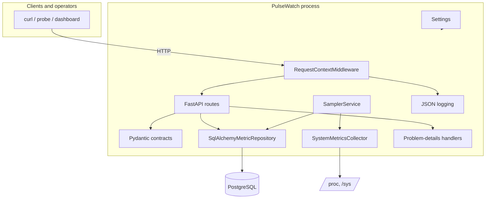

# Architecture

## Goals

PulseWatch is a small, reliable Linux monitoring service built to demonstrate
production-oriented Python without obscuring operational detail. Its priorities
are:

1. **Deterministic host telemetry** with psutil as the only sampling source.
2. **Durable samples** in PostgreSQL with a reproducible schema.
3. **A stable HTTP contract** that is easy to consume and operate.
4. **Observable failure** through structured logs, correlation IDs, and
   dependency-aware readiness.
5. **Testability** through explicit application composition and test doubles.

## Current components



| Module | Responsibility |
| --- | --- |
| `pulsewatch.main` | Composition root, lifespan, route registration |
| `pulsewatch.core.config` | Environment/.env parsing and validation |
| `pulsewatch.core.logging` | JSON/console formatting, request context |
| `pulsewatch.core.middleware` | Request IDs, access logs, last-resort error boundary |
| `pulsewatch.core.errors` | RFC 9457 responses and framework exception handlers |
| `pulsewatch.api` | Route definitions and response schemas |
| `pulsewatch.collectors` | Collector protocol and psutil implementation |
| `pulsewatch.db` | Async engine, SQLAlchemy model, repository |
| `pulsewatch.services.sampler` | Fixed-cadence collection loop |
| `migrations` | Alembic environment and schema versions |

## Startup and shutdown

The FastAPI lifespan owns long-lived resources:

1. `create_app()` constructs the database engine, repository, collector, and
   sampler. Creating an engine does not open a database connection.
2. On startup, the sampler task is created. It attempts its first collection
   immediately.
3. On shutdown, the sampler stop event is set and the task is awaited.
4. The database engine is disposed.

If PostgreSQL is unavailable at startup, the API still starts; sampling fails,
`/health/ready` reports degraded, and the sampler retries on the next interval.
In Compose, the app waits for PostgreSQL and runs Alembic before startup, so this
scenario is primarily relevant to dependency loss after startup.

## Sampling lifecycle

The sampler is the **only** caller of psutil:

```text
collector.collect() (worker thread)
        ↓
repository.save_snapshot() (async PostgreSQL write)
        ↓
last_success_at updated
        ↓
wait for interval or shutdown
```

Details:

- psutil is blocking, so collection runs through `asyncio.to_thread`.
- The loop subtracts collection/write time from the interval to avoid drift.
- Write failures are logged with a traceback and do not terminate the task.
  Readiness turns stale after the configured freshness window.
- The first sample uses a very short CPU measurement window; subsequent samples
  use the configured interval.
- The sampler is a single in-process task. Running multiple API workers would
  create one sampler per worker and duplicate writes; this is why the current
  deployment model is one application process.

## Request lifecycle

1. Uvicorn accepts the HTTP connection.
2. `RequestContextMiddleware` resolves or generates a request ID and starts a
   timer.
3. FastAPI routes the request.
4. Metrics routes read the latest stored sample from the repository. Health
   routes query the repository or sampler state. No route calls psutil.
5. Pydantic serialises the response.
6. The middleware adds the request ID header and writes an access log.
7. Unexpected exceptions become a generic `500` problem response; known
   framework and validation errors use dedicated handlers.

## Persistence

The `metric_samples` table stores one row per snapshot:

- Identity primary key
- UTC `collected_at`
- Hostname
- Scalar CPU, memory, and disk percentages for future filtering and aggregation
- Full snapshot payload as `JSONB`

Indexes:

- `collected_at`
- `(hostname, collected_at)`

The model is in `pulsewatch.db.models`; the repository hides SQLAlchemy from the
API. PostgreSQL is the production target, while SQLite covers fast repository
tests. Production JSON is stored as `JSONB`; the model uses a JSON variant so the
same repository logic can run against SQLite in tests.

Alembic owns the schema. The application does not call `create_all()` at
startup. Compose runs `alembic upgrade head` before starting the app; the systemd
unit uses `ExecStartPre`.

## Readiness semantics

Readiness validates:

- Database connectivity through `SELECT 1`.
- Sampler freshness: a successful write within the stale threshold.

It deliberately does not call psutil. Readiness may be `503` briefly after
startup before the first sample is stored. Liveness remains a process-only check
so a database outage does not trigger pointless restarts.

Readiness returns the health schema with per-dependency checks and status `503`
when degraded. Other API failures use problem details.

## Logging

Logs are JSON by default, one object per line on stderr:

```json
{
  "timestamp": "2026-11-11T16:48:27.697043+00:00",
  "level": "info",
  "logger": "pulsewatch",
  "message": "request completed",
  "request_id": "trace-42",
  "http_method": "GET",
  "path": "/api/v1/metrics/current",
  "client_ip": "127.0.0.1",
  "status_code": 200,
  "duration_ms": 4.18
}
```

Uvicorn's server and error loggers are redirected through the root handler.
Uvicorn's access logger is suppressed because the middleware emits richer access
entries. Errors include formatted tracebacks in the `exception` field. Local
development can opt into console output with
`PULSEWATCH_LOG_FORMAT=console`.

Database URLs are held as `SecretStr` and are not included in application
configuration representations.

## Error handling

Three layers:

1. Framework HTTP exceptions and request-validation errors are converted by
   registered handlers.
2. The metrics endpoint maps repository failures and an empty store to `503`
   problem details.
3. Unexpected exceptions are caught by the request middleware, logged with a
   traceback, and replaced with a generic response.

## Testing strategy

- Route tests use a fake repository and collector; they do not require a
  database.
- Sampler tests use a fake collector/repository and a real asyncio loop.
- Repository tests run against SQLite for fast coverage of query and JSON
  round-tripping.
- PostgreSQL integration tests run against a migrated database when
  `PULSEWATCH_TEST_DATABASE_URL` is set; CI provides a PostgreSQL service.
- The container CI job builds the image and starts the real Compose stack,
  checking migration, readiness, and a stored sample.

## Next design steps

- History API with bounded time ranges and pagination.
- Retention job with batched deletes.
- Multi-process safety or a dedicated sampler process if scaling beyond one
  application worker.
- Authentication at the edge if the API is exposed beyond loopback.
