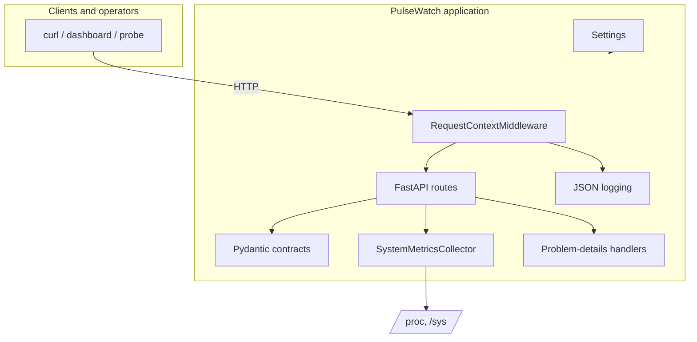
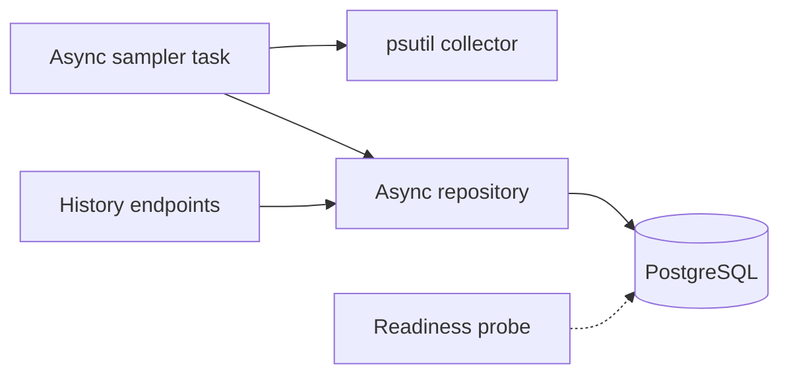

# Architecture

## Goals

PulseWatch is a small, reliable service that demonstrates production-oriented
Python without hiding operational complexity. Its design priorities are:

1. **Correct host telemetry** with psutil as the only privileged read path.
2. **A stable HTTP contract** that is easy to consume and operate.
3. **Observable failure** through structured logs and correlation IDs.
4. **Testability** by keeping process wiring at the application boundary.
5. **Clear deployment paths** for systemd and containers.

## Current components



| Module | Responsibility |
| --- | --- |
| `pulsewatch.main` | Composition root, lifespan, route registration |
| `pulsewatch.core.config` | Environment and `.env` parsing, validation |
| `pulsewatch.core.logging` | JSON/console formatting, request context |
| `pulsewatch.core.middleware` | Request IDs, access logs, last-resort error boundary |
| `pulsewatch.core.errors` | RFC 9457 responses and framework exception handlers |
| `pulsewatch.api` | Route definitions and response schemas |
| `pulsewatch.collectors` | Collector protocol and psutil implementation |

## Request lifecycle

1. Uvicorn accepts the HTTP connection and invokes the ASGI application.
2. `RequestContextMiddleware` resolves or generates a request ID, stores it in a
   `ContextVar`, and records a start timestamp.
3. FastAPI routes the request. Health and metrics endpoints are synchronous
   functions, so FastAPI runs them in its worker threadpool.
4. The collector reads `/proc`, `/sys`, and OS interfaces through psutil and
   returns a validated `SystemSnapshot`.
5. FastAPI serialises the Pydantic model as JSON.
6. The middleware adds the request ID header and emits a structured access log
   with method, path, status, duration, and client address.
7. If an exception escapes the route, the middleware logs the traceback and
   returns a generic `500` problem-details response. The correlation ID is
   preserved.

Framework errors (`404`, `405`) and validation failures are converted by
exception handlers before they return to the middleware.

## Concurrency model

The service uses a single Uvicorn worker by default. That is intentional for the
current feature set: psutil calls are short, CPU-bound only at the boundary, and
the API is read-only.

- psutil calls are synchronous and executed in FastAPI's threadpool.
- The collector is stateless except for psutil's CPU sampling baselines.
- A process-wide `Settings` instance is cached after first load.
- No mutable request state is shared between requests; the request ID lives in a
  context variable.

Multiple Uvicorn workers are not recommended yet: each worker would keep its own
CPU baselines, and the future sampler must be designed for exactly-once
collection before scaling out.

## Logging

Logs are JSON by default, one object per line on stdout/stderr:

```json
{
  "timestamp": "2026-11-10T17:02:43.521912+00:00",
  "level": "info",
  "logger": "pulsewatch.core.middleware",
  "message": "request completed",
  "request_id": "trace-42",
  "http_method": "GET",
  "path": "/api/v1/metrics/current",
  "client_ip": "127.0.0.1",
  "status_code": 200,
  "duration_ms": 4.18
}
```

Uvicorn's server and error loggers are redirected through the root handler so
startup, shutdown, and server errors share the same format. Uvicorn's access
logger is deliberately suppressed: the middleware emits richer access entries
with the request ID and duration. Errors include the formatted traceback in the
`exception` field. Local development can opt into compact console output with
`PULSEWATCH_LOG_FORMAT=console`.

## Error handling

There are three layers:

1. **Validation and framework exceptions** are converted by registered handlers.
2. **Unexpected exceptions** are caught by the request middleware, logged with a
   traceback, and replaced with a generic problem response.
3. **ASGI-level failures before the middleware** fall back to Starlette's server
   error handling; Uvicorn still logs them.

The response contract is documented in [api.md](api.md#errors). Internal
exception text is never returned to the caller.

## Planned persistence

The next milestone adds PostgreSQL without changing the current API contract.



Proposed design:

- **SQLAlchemy 2.x async engine** with `asyncpg`, managed by Alembic.
- A `metric_samples` table keyed by `(id, collected_at)`, indexed on
  `(hostname, collected_at DESC)`.
- Scalar columns for frequently queried values (`cpu_percent`,
  `memory_percent`, `disk_percent`) plus a JSONB payload for the full snapshot.
- A single background sampling task started in the FastAPI lifespan. It uses the
  same collector interface as the live endpoint.
- Bounded queue/backpressure: if the database is slow, samples are dropped and a
  warning is logged rather than blocking API traffic.
- Retention enforced by a periodic `DELETE` job or partitioning, configurable via
  environment settings.
- Readiness requires the database only when history is enabled.
- A separate `/api/v1/metrics/history` endpoint with time-range and pagination
  parameters.

The persistence layer will sit behind a repository protocol so route and service
tests can continue to run without a database. A PostgreSQL service will be
added to Compose and the CI integration job.

## Deployment topology

- **systemd:** the host-native deployment. Full host visibility, no container
  namespace boundaries. The unit is sandboxed and reads configuration from
  `/etc/pulsewatch/pulsewatch.env`.
- **Docker:** reproducible image, unprivileged by default, suitable for demos and
  non-host-specific deployments. A container has its own mount and network
  namespaces, so disk and network values describe the container rather than the
  full host. See [deployment.md](deployment.md#container-visibility).

## Future concerns

- Authentication/rate limiting at the edge; the API is currently loopback-only.
- Multi-host identity in stored samples.
- Sampling and retention backpressure metrics.
- Load testing to establish capacity and the worker model.
- OpenTelemetry traces if the service grows beyond a single process.
